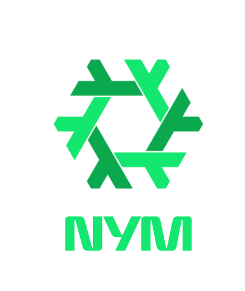

<div align="center">



# nym-vpn.nixos

**[NymVPN](https://github.com/nymtech/nym-vpn-client) Privacy-preserving VPN for NixOs**

</div>

## Install

### With flake

Add the repo url to your configuration(flake) input.

```nix
#flake.nix
inputs = {
  nym-vpn.url = "github:crocuda/nym-vpn.nixos";
}
```

Import and configure the nixos module.

```nix
# random config file
{
config,
user,
...
}: {
  imports = [
    inputs.nym-vpn.nixosModules.default
  ];
  config.services.nym-vpn.users = [ <your_username> ];
}
```

You may find the full list of options at `_nixos/options.nix`

For example, you can set your favorite version for the core and the gui.

```nix
# random config file
{
config,
user,
...
}: {
  imports = [
    inputs.nym-vpn.nixosModules.default
  ];
  config.services.nym-vpn = {
    enable = true;
    users = [ <your_username> ];
    # Pin a core version.
    core = {
        version = "2026.15.0";
        sha256 = "sha256-SkbS2fs9ytC8r3PvHrw7/PDyjq1M1TAEsM7QuMTgD80=";
    };
    # Pin a gui version.
    gui = {
        enable = true;
        version = "2026.15.0";
        sha256 = "sha256-SkbS2fs9ytC8r3PvHrw7/PDyjq1M1TAEsM7QuMTgD80=";
    };
    # Whether you can access LAN while connected to the VPN
    lan = {
      enable = true;
    };
    # Add default nameservers,
    # You can query a local nameserver when LAN access is enabled
    nameservers = [
      # home
      "192.168.1.1"
      "fe80::1"
      # quad9
      "9.9.9.9"
      "2620:fe::fe"
    ];
  };
}
```

### With flake + Flatpak client support

This module can also be used with the official NymVPN Flatpak client.

In that case:

- Disable the GUI installation via nix.

```nix
config.services.nym-vpn.gui.enable = false;
```

This option will:

- keep the `nym-vpnd` service,
- keep the Polkit configuration,
- keep the runtime PATH and capabilities fixes,
- and remove the AppImage client package and MIME associations.

However, using the AppImage client keeps GUI and daemon versions synchronized through NixOS configuration, which is generally more reproducible and reliable on NixOS systems.

### With denful flake (dendritic)

Add the repo url to your configuration(flake) input.

```nix
#flake.nix
inputs = {
  nym-vpn.url = "github:crocuda/nym-vpn.nixos";
}
```

The user will be automatically detected from your configuration.
No need to set further configuration.

```nix
# random config file
imports = [
  inputs.nym-vpn.flakeModules.default
];
den.aspects.<my_aspect> = {
  includes = [
    nym-vpn.aspects.nym-vpn
    # or for autologin and autoconnect:
    nym-vpn.aspects.nym-vpn.sops
  ];
};
```

## Usage

### Auto-connect (with sops)

```nix
#flake.nix
inputs = {
  nym-vpn.url = "github:crocuda/nym-vpn.nixos";
}
```

Add your nym account secret key to your secret file.

```sh
sops edit secrets/secrets.yaml
```

```yaml
nym-vpn:
  secret: |
    your 24 word secret seed
```

Enable secret management in your config.

```nix
#flake.nix
sops-nix = {
  url = "github:Mic92/sops-nix";
  inputs.nixpkgs.follows = "nixpkgs";
};
```

```nix
imports = [
  inputs.sops-nix.nixosModules.sops
];
config.services.nym-vpn.account.secret.enable = true;

```

Credit to original work by @VicentKimFr.
